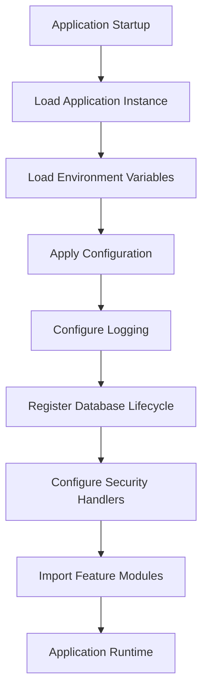
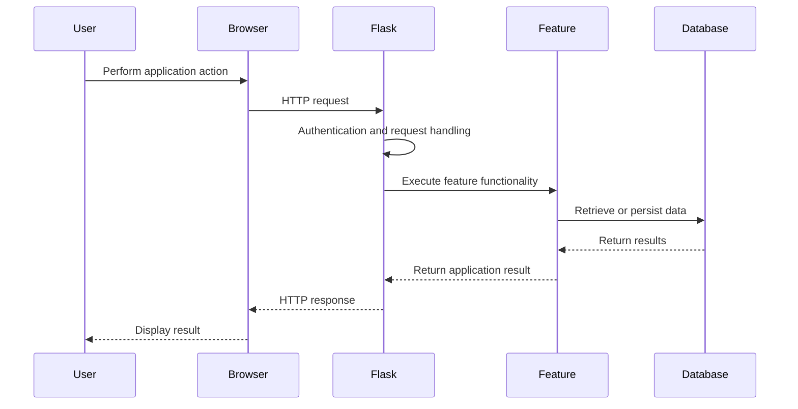

# Application Architecture

## 1. Overview

STS follows a feature-oriented monolithic architecture implemented using Python and Flask.

The application is organized into functional modules, with shared services, statistical analysis components, database functionality, and utility modules supporting the main application features.

All functional areas execute within the same application deployment and share the application's persistence layer.

The architecture prioritizes:

- Clear functional responsibilities.
- Low deployment complexity.
- Reuse of shared functionality.
- Consistent database access.
- Maintainability within a single application.
- Independent testing of business-critical calculations.

This document describes the current application structure, its main architectural components, and potential improvements.

## 2. Repository Structure

The repository is organized into the following main areas:

```text
.
├── analyze/
├── data/
├── migrations/
├── services/
├── static/
├── templates/
├── tests/
├── utils/
│
├── app.py
├── analytics.py
├── asset_classifier.py
├── config.py
├── dashboard.py
├── database.py
├── extensions.py
├── gallery.py
├── journal.py
├── knowledge.py
├── login.py
├── notes.py
├── settings.py
├── spot.py
├── symbol_icons.py
├── todo.py
├── trades.py
│
├── Dockerfile
├── compose.yaml
├── requirements.txt
└── README.md
```

The repository separates application functionality, statistical analysis, supporting services, presentation assets, database migrations, and automated tests.

## 3. Application Composition

### 3.1 Application Entry Point

`app.py` acts as the main application composition and execution module.

Its responsibilities include:

- Loading environment configuration.
- Applying application configuration.
- Initializing logging.
- Registering database connection cleanup.
- Loading the authenticated user into the request context.
- Configuring CSRF error handling.
- Applying security response headers.
- Importing and exposing feature routes.
- Registering shared template functionality.
- Starting the development server when executed directly.

The application instance is imported from `extensions.py`.

### 3.2 Application Initialization Flow



This diagram represents the main initialization responsibilities rather than every internal execution detail.

## 4. Functional Modules

### 4.1 Trading Module

**Primary file:** `trades.py`

Responsible for trade-related application functionality.

Its responsibilities include:

- Trade creation and management.
- Trade lifecycle operations.
- Position information.
- Partial position closures.
- Trade-related information retrieval.

The trading module is central to the application's domain model because other subsystems depend on historical trading information.

### 4.2 Analytics Module

**Primary file:** `analytics.py`

Responsible for exposing quantitative performance analysis functionality.

It uses the statistical analysis components in the `analyze/` package to support calculations and performance reporting.

The analytical domain includes:

- Performance statistics.
- Risk-normalized results.
- Trade outcome distributions.
- Directional analysis.
- Asset and symbol analysis.
- Drawdown-related measurements.

The long-term architectural objective is to keep calculation logic independent from Flask request handling and persistence concerns.

### 4.3 Dashboard Module

**Primary file:** `dashboard.py`

Responsible for presenting an overview of relevant application and trading information.

The dashboard consumes information maintained by other application components and presents summarized results to the user.

### 4.4 Journal Module

**Primary file:** `journal.py`

Responsible for qualitative trading documentation.

Its functionality includes journal-related information, reflections, and historical reviews.

The journal provides contextual information that complements quantitative trade performance.

### 4.5 Knowledge Module

**Primary file:** `knowledge.py`

Responsible for managing the trading knowledge base.

This allows research material and educational content to be maintained alongside trading history.

### 4.6 Gallery Module

**Primary file:** `gallery.py`

Responsible for visual trading material, including chart screenshots and other supporting images.

### 4.7 Authentication Module

**Primary file:** `login.py`

Responsible for authentication-related application functionality.

Security responsibilities include authentication enforcement and integration with the application's session handling.

### 4.8 Supporting Modules

| Module | Responsibility |
|---|---|
| `notes.py` | Notes functionality |
| `settings.py` | Application settings |
| `todo.py` | Task management |
| `spot.py` | Additional spot-related functionality |
| `asset_classifier.py` | Asset classification |
| `symbol_icons.py` | Symbol-related visual support |

The exact internal responsibilities and dependencies of these modules should be expanded as their implementations are reviewed.

## 5. Shared Infrastructure

### 5.1 Database Layer

**Primary file:** `database.py`

Responsible for database initialization and database connection functionality.

The database layer provides shared persistence functionality to application components.

Its responsibilities include:

- Database initialization.
- Connection management.
- Schema management.
- Referential integrity.
- Database lifecycle cleanup.

### 5.2 Extensions

**Primary file:** `extensions.py`

Provides the Flask application instance and shared application extension configuration.

This creates a common integration point for functionality used throughout the application.

### 5.3 Configuration

**Primary file:** `config.py`

Centralizes application configuration.

Environment-dependent configuration should remain separate from business logic.

Sensitive configuration values should be provided through environment variables or appropriate secret-management mechanisms.

### 5.4 Shared Services

**Directory:** `services/`

Contains reusable application services.

Services provide an opportunity to isolate functionality that is shared across multiple application features.

### 5.5 Statistical Analysis

**Directory:** `analyze/`

Contains statistical and quantitative analysis components.

Keeping calculation-related functionality in a dedicated package creates an opportunity for independent testing and reuse.

The intended architectural direction is to make these calculations independent of HTTP request handling.

### 5.6 Utilities

**Directory:** `utils/`

Contains reusable helper functionality.

Utilities should remain focused on generic technical operations rather than becoming a location for unrelated business rules.

## 6. Presentation Architecture

The application uses Flask's server-side rendering capabilities.

The presentation layer consists of:

- Jinja templates in `templates/`.
- Static CSS.
- JavaScript.
- Images and supporting assets in `static/`.

The browser communicates with Flask through HTTP requests.

The application processes incoming requests and returns rendered HTML or other appropriate HTTP responses.

### 6.1 Request Lifecycle



Individual features may follow different internal execution paths.

## 7. Database Access and Resource Lifecycle

The application uses SQLite for persistent storage.

Database connection cleanup is registered through Flask's application-context teardown mechanism.

The current application therefore relies on Flask's request/application context to manage database resource lifecycles.

Important engineering considerations include:

- Connection ownership.
- Transaction boundaries.
- Exception handling.
- Commit and rollback behavior.
- Foreign-key enforcement.
- Concurrent access.
- Query performance.

Future architectural work should establish consistent database access conventions across all feature modules.


