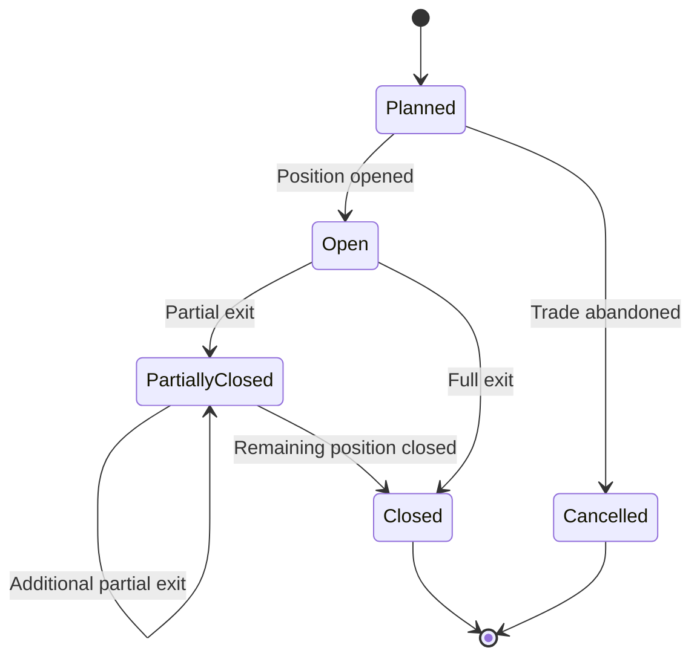
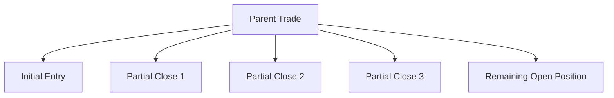
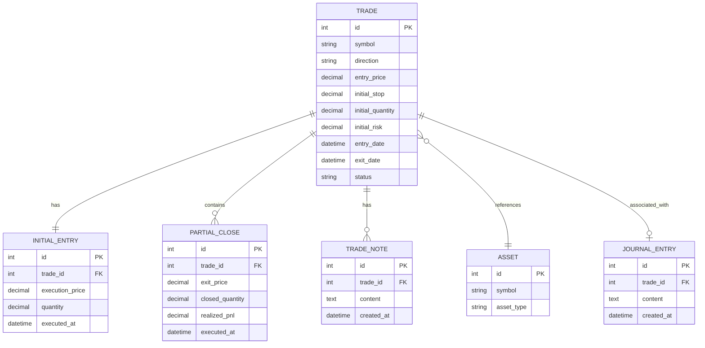

# Domain Model

## 1. Overview

The STS domain model describes the core business concepts, entities, relationships, and lifecycle rules that govern the trading journal and quantitative performance analysis system.

The central domain concept is the **Trade**.

A trade represents a logical trading position with an associated entry, initial risk definition, position management history, and realized financial outcome.

The domain model must preserve the relationship between the original trading decision and all subsequent position management activities.

This is particularly important when a position is closed through multiple partial exits.

The primary design objectives are:

- Preserve trade lifecycle information.
- Maintain consistent relationships between trades and partial executions.
- Distinguish initial risk from realized performance.
- Ensure accurate risk-normalized calculations.
- Preserve historical trading information.
- Prevent invalid or inconsistent domain states.

## 2. Core Domain Concepts

The primary domain concepts are:

| Concept | Description |
|---|---|
| Trade | Represents a logical trading position |
| Entry | Represents the opening execution or entry information |
| Partial Close | Represents an individual reduction or closure of an existing position |
| Initial Risk | Represents the monetary amount initially exposed to risk |
| Realized Result | Represents the final financial outcome of executed position activity |
| R-Multiple | Represents performance relative to initial monetary risk |
| Journal Entry | Represents qualitative information associated with trading activity |
| Trading Note | Represents additional observations or documentation |
| Trading Session | Represents a period of trading activity |
| Asset / Symbol | Identifies the instrument being traded |

These concepts describe the business domain. Their exact implementation and persistence representation must be verified against the database schema.

## 3. Trade Entity

A Trade represents a logical trading position.

It is the primary entity around which trade management and performance analysis are organized.

### 3.1 Trade Attributes

A trade may contain the following information:

| Attribute | Description |
|---|---|
| Trade ID | Unique identifier |
| Symbol | Traded financial instrument |
| Direction | LONG or SHORT |
| Entry Price | Initial entry price |
| Initial Stop Loss | Stop-loss level at trade initiation |
| Initial Target | Intended target price, if defined |
| Initial Quantity | Original position quantity |
| Initial Risk | Monetary amount initially at risk |
| Entry Date | Date and time of entry |
| Exit Date | Date and time of final closure |
| Status | Current lifecycle state |
| Strategy | Strategy or trading approach |
| Setup | Specific trading setup |
| Notes | Associated qualitative information |

The exact attributes depend on the implemented database schema.

### 3.2 Trade Responsibilities

The Trade concept is responsible for preserving:

- The original trading decision.
- Position direction.
- Initial position sizing.
- Initial risk definition.
- Position management history.
- Relationships to partial closes.
- Overall lifecycle status.

A trade should remain identifiable as one logical trading decision even when its position is managed through multiple executions.

## 4. Position Lifecycle

A trade moves through a lifecycle as the position is opened, managed, and eventually closed.

A conceptual lifecycle is:



The states above represent a proposed domain lifecycle and should be aligned with the actual application implementation.

### 4.1 Open

The position has been established and remains active.

### 4.2 Partially Closed

A portion of the original position has been closed while a remaining quantity is still open.

### 4.3 Closed

The entire position has been closed.

No remaining open quantity should exist.

### 4.4 Cancelled

A planned trade was abandoned without an executed opening position.

This state is relevant only if the application explicitly supports planned trades.

## 5. Partial Position Closures

Partial closures are an important part of the STS domain model.

A single trading position may be reduced through multiple exit executions.

Each partial close represents an individual event associated with the original trade.

### 5.1 Relationship Model



The parent trade maintains the overall identity of the position.

Individual partial closes preserve the details of how that position was managed.

### 5.2 Partial Close Attributes

A partial close may contain:

| Attribute | Description |
|---|---|
| Partial Close ID | Unique identifier |
| Trade ID | Reference to the parent trade |
| Exit Price | Price at which quantity was closed |
| Closed Quantity | Quantity removed from the position |
| Exit Date | Date and time of execution |
| Fees | Associated execution costs, if recorded |
| Realized P/L | Financial result of the partial closure |
| Exit Reason | Reason for the position reduction |
| Notes | Additional execution information |

### 5.3 Position Quantity Invariant

The sum of closed quantities must never exceed the original position quantity.

For a position without additional entries:

```text
Initial Quantity = Remaining Quantity + Total Closed Quantity
```

Where:

```text
Total Closed Quantity = SUM(Partial Close Quantities)
```

Therefore:

```text
Remaining Quantity = Initial Quantity - Total Closed Quantity
```

The following invariant must hold:

```text
0 <= Total Closed Quantity <= Initial Quantity
```

This is a fundamental domain integrity requirement.

## 6. Risk Model

Risk is a central concept in STS.

The system uses initial monetary risk as the reference point for measuring trading performance.

### 6.1 Initial Risk

Initial risk represents the amount of capital exposed to loss when the position is established.

For a simple linear instrument:

```text
Initial Risk = ABS(Entry Price - Initial Stop Loss) × Position Quantity × Point Value
```

The actual calculation depends on the instrument's contract specification, currency, and trading fees.

The initial risk should represent the original risk assumption rather than being silently recalculated from subsequent stop-loss modifications.

### 6.2 Realized Risk

Realized performance is calculated from the actual outcomes of all position exits.

For multiple partial closes:

```text
Realized P/L = SUM(Partial Close Realized P/L)
```

If the application records entry and exit fees separately, those costs must be included consistently.

### 6.3 R-Multiple

R-multiple expresses the realized result relative to initial monetary risk.

```text
Realized R = Net Realized P/L / Initial Risk
```

Example:

| Parameter | Value |
|---|---:|
| Initial Risk | €100 |
| Realized P/L | €250 |
| Realized R | +2.5R |

This allows trading performance to be compared across positions with different sizes and monetary exposure.

### 6.4 Risk Integrity Requirements

The domain model should enforce or validate the following:

- Initial risk must be positive for a valid risk-normalized trade.
- Position quantities must be valid and non-negative.
- Closed quantities cannot exceed original quantity.
- Realized results must account for all executed exits.
- Currency conversions must be handled consistently.
- Missing risk information must not be silently interpreted as zero risk.

## 7. Domain Relationships

The following diagram describes the conceptual relationships between the main trading entities.



> **Note:** This is a conceptual domain relationship diagram. It does not assert that all these entities exist as separate database tables in the current implementation.

## 8. Supporting Domain Concepts

### 8.1 Asset / Symbol

An asset identifies the financial instrument associated with a trade.

Examples include:

- EURUSD
- GBPUSD
- NASDAQ
- S&P 500
- Gold
- Bitcoin

Asset classification enables performance analysis across different instrument categories.

### 8.2 Strategy and Setup

A strategy describes the broader trading methodology.

A setup represents a specific market condition or entry pattern within that methodology.

Separating these concepts enables more detailed performance attribution.

For example:

```text
Strategy: Trend Following

    Setup A: Pullback Entry
    Setup B: Breakout Continuation
    Setup C: Moving Average Retest
```

This distinction allows STS to evaluate which trading approaches produce the strongest historical results.

### 8.3 Journal Entry

A journal entry stores qualitative trading information.

Examples include:

- Daily trading observations.
- Emotional state.
- Execution discipline.
- Market observations.
- Lessons learned.
- Monthly performance reviews.

Journal information complements quantitative results by providing context that numerical metrics alone cannot capture.

## 9. Domain Invariants

Domain invariants define conditions that must remain true regardless of which application feature creates or modifies a record.

These rules are important because they prevent invalid trading data from entering the system.

| Invariant | Requirement |
|---|---|
| Trade Identity | Every trade must have a unique identifier |
| Trade Direction | Direction must be LONG or SHORT |
| Initial Risk | Must be positive for risk-normalized calculations |
| Position Quantity | Must be non-negative |
| Partial Closures | Closed quantity cannot exceed original quantity |
| Remaining Quantity | Cannot be negative |
| Trade Closure | A fully closed trade must have zero remaining quantity |
| Realized P/L | Must account for all recorded executions |
| R-Multiple | Must use the original valid initial risk |
| Referential Integrity | Partial closes must reference an existing trade |

These invariants should be enforced through a combination of:

- Database constraints.
- Application-level validation.
- Domain-level validation.
- Automated tests.

## 10. Data Integrity and Historical Consistency

Trading records represent historical financial activity.

The system should preserve the original information needed to reconstruct historical performance.

Important requirements include:

- Preserve original entry information.
- Preserve initial risk assumptions.
- Record individual exit executions.
- Avoid silently overwriting historical execution data.
- Maintain consistent relationships between parent trades and partial closes.
- Ensure recalculated performance remains reproducible.

Corrections to historical records should be explicit rather than silently changing historical information.

Where appropriate, an audit trail can preserve previous values and modification timestamps.

## 11. Domain Model and Analytics Separation

The domain model describes trading activity.

The analytics subsystem interprets that activity and calculates performance indicators.

These responsibilities should remain conceptually separate.

| Domain Responsibility | Analytics Responsibility |
|---|---|
| Store trade information | Calculate performance metrics |
| Preserve position lifecycle | Calculate realized R |
| Record partial closes | Calculate weighted trade outcomes |
| Maintain initial risk | Calculate risk-adjusted statistics |
| Preserve execution history | Calculate drawdown and equity curves |
| Store strategy information | Evaluate strategy performance |

Analytics should consume validated domain information rather than independently redefining the underlying trading rules.

## 12. Future Domain Evolution

Potential future improvements include:

- Explicit execution entities.
- Multiple entries per logical trade.
- Scale-in and scale-out position management.
- Strategy and setup classification.
- MAE and MFE tracking.
- Trade tagging.
- Execution fee allocation.
- Currency conversion support.
- Immutable execution history.
- Domain-level audit events.
- Portfolio-level risk attribution.

These capabilities should be introduced according to actual requirements rather than increasing domain complexity prematurely.

## 13. Domain Design Principles

The STS domain model should follow these principles:

1. A trade represents one logical trading decision and position lifecycle.
2. Individual executions should remain traceable to their parent trade.
3. Initial risk must remain distinguishable from realized performance.
4. Partial closures must preserve position quantity consistency.
5. Historical execution information should remain reproducible.
6. Quantitative calculations should use explicitly defined financial rules.
7. Domain logic should remain independent of presentation and HTTP handling.

## 14. Summary

The STS domain model is centered around the Trade entity and its associated position lifecycle.

Partial closures, initial risk, realized performance, and R-multiples form the foundation of its quantitative trading model.

Maintaining explicit relationships and domain invariants is essential for ensuring that historical performance calculations remain accurate and reproducible.

**The central domain design objective is to preserve the complete lifecycle of a trading position while maintaining financial consistency and reliable risk-normalized performance measurement.**

## Related Documentation

- [System Overview](system-overview.md)
- [Application Architecture](application-architecture.md)
- [Data Flow](data-flow.md)
- [Architecture Decisions](architecture-decisions.md)
- [Database Design](../engineering/database-design.md)
- [Analytics Engine](../engineering/analytics-engine.md)
