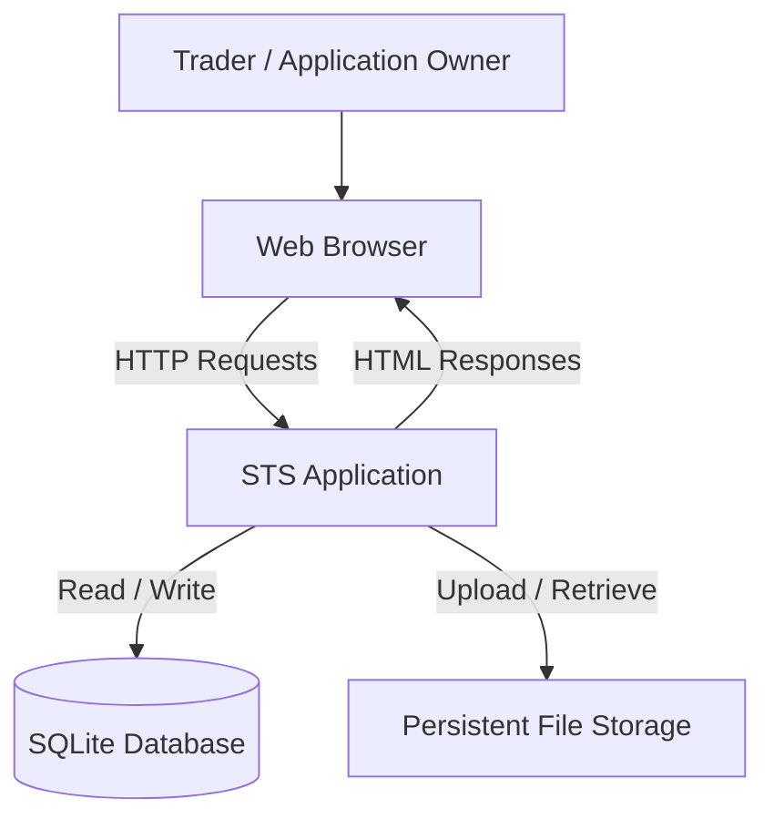
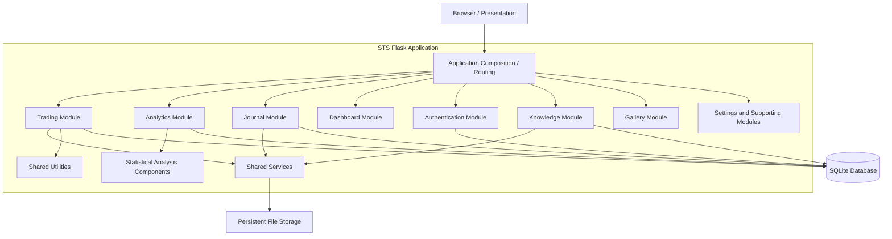
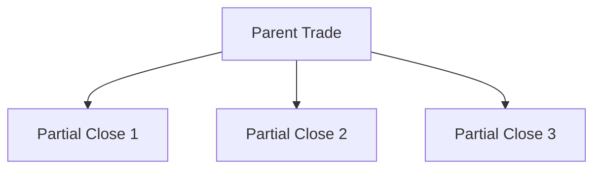
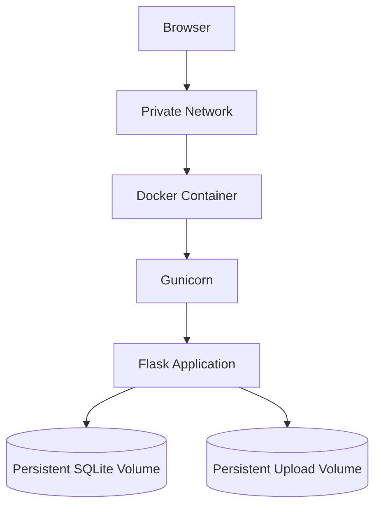

# STS — System Architecture Overview

## System Description

STS (Smarter Trading Systems) is a self-hosted trading journal and quantitative performance analysis application designed to help traders measure, understand, and improve their trading process.

The application combines trade lifecycle management, quantitative performance analytics, risk evaluation, and qualitative trading reviews within a single application.

The central feedback loop is:

**Record → Measure → Review → Identify Patterns → Improve**

## Project Objectives

The system has five primary objectives:

- **Trade Lifecycle Management:** Record and maintain historical trading activity, including partial position closures.
- **Quantitative Performance Measurement:** Evaluate trading results using risk-normalized metrics.
- **Risk Analysis:** Understand the relationship between initial risk, realized outcomes, and drawdown.
- **Qualitative Review:** Associate trades with notes, screenshots, observations, and trading rules.
- **Continuous Improvement:** Identify recurring patterns and evaluate changes to trading behavior.

## Architectural Philosophy

STS follows a lightweight, feature-oriented monolithic architecture.

The application deliberately avoids unnecessary distributed infrastructure and microservice decomposition.

This architectural approach is based on the current application scope:

- Single-user application.
- Self-hosted deployment.
- Relatively low concurrency requirements.
- Strong transactional consistency requirements.
- Limited operational complexity.
- No demonstrated need for independently scalable services.

The objective is to maintain clear internal architectural boundaries while retaining the operational simplicity of a monolithic deployment.

## System Context

STS operates as a private application accessed through a web browser.

The user records trading activity, maintains journal entries, manages supporting material, and requests historical performance analysis.

## Technology Stack

| Component | Technology | Responsibility |
|---|---|---|
| Programming Language | Python | Core application logic |
| Web Framework | Flask | HTTP request handling and application routing |
| Application Server | Gunicorn | Production WSGI server |
| Database | SQLite | Relational data persistence |
| Data Processing | Pandas | Data manipulation and analytical processing |
| Statistical Analysis | Python / NumPy / SciPy | Quantitative calculations and statistical evaluation |
| Frontend | HTML / CSS / JavaScript | User interface and client-side interactions |
| Templating | Jinja2 | Server-side HTML rendering |
| Authentication | Flask-Bcrypt | Password hashing |
| CSRF Protection | Flask-WTF | Cross-site request forgery protection |
| Rate Limiting | Flask-Limiter | Request rate controls |
| Image Processing | Pillow | Image manipulation and validation |
| Spreadsheet Processing | OpenPyXL | Excel file processing |
| Containerization | Docker | Application packaging and deployment |
| Orchestration | Docker Compose | Container configuration and lifecycle management |

## Logical Architecture

The application is organized around functional responsibilities rather than independently deployed services.

| Functional Area | Responsibility |
|---|---|
| Trading Management | Trade creation, modification, lifecycle management, and partial closes |
| Analytics | Historical performance calculations and statistical analysis |
| Risk Management | Initial risk, realized R, and risk-related performance evaluation |
| Trading Journal | Daily entries, monthly reviews, reflections, and observations |
| Knowledge Base | Storage and organization of trading-related learning material |
| Gallery | Visual reference material, chart screenshots, and trade examples |
| User Management | Authentication, sessions, and application access |
| Supporting Services | Formatting, media processing, and reusable application functionality |

### Logical Component Diagram

## Core Domain Concepts

### Trade

A trade represents a logical trading position.

It contains information such as:

- Instrument or symbol.
- Direction (LONG or SHORT).
- Entry information.
- Initial stop loss.
- Target information.
- Initial risk.
- Trade lifecycle information.
- Associated notes and supporting material.

### Partial Position Closures

STS supports multiple partial exits associated with an original trade.

Partial exits are treated as components of the original position rather than unrelated independent trades.

This preserves the relationship between the initial position and subsequent position management.

### R-Multiple as the Primary Performance Unit

STS uses R-multiples as its primary risk-normalized performance measure.

**1R represents the initial amount risked on a trade.**

| Result | Interpretation |
|---|---|
| +3R | Three times the initial risk |
| +2R | Twice the initial risk |
| +1R | Equal to the initial risk |
| 0R | Break-even |
| -1R | Full initial risk lost |

Using R-multiples makes historical outcomes more comparable across positions with different monetary sizes.

## Quantitative Analytics

The analytics subsystem transforms historical trading records into performance indicators.

Metrics include:

- Average R.
- Median R.
- Win rate.
- Profit factor.
- Payoff ratio.
- R distribution.
- Long versus short performance.
- Symbol and asset performance.
- Trade duration.
- Winning and losing streaks.
- Drawdown-related metrics.
- Performance over different time periods.

The analytics philosophy is descriptive rather than predictive.

STS aims to explain historical trading behavior, not forecast future market movements.

### Quantitative Correctness Requirements

The analytics subsystem must account for:

- Partial-close weighting.
- Initial versus realized risk.
- Consistent treatment of break-even outcomes.
- Clearly defined profit factor calculations.
- Drawdown methodology.
- Sample-size limitations.
- Financial precision and rounding.
- Missing or incomplete historical records.

Calculation definitions should be documented and protected by automated tests.

## Data and Persistence Architecture

SQLite is the primary persistence mechanism.

The database stores application records and their relationships.

Important database engineering considerations include:

- Referential integrity.
- Transaction boundaries.
- Database constraints.
- Indexing strategy.
- Schema evolution.
- Historical data preservation.
- Backup and recovery procedures.

Uploaded media and other supporting files require persistent storage separate from the application's ephemeral container filesystem.

### Data Ownership

The application owns its recorded trading history and associated journal information.

Historical records should not be silently discarded or modified by analytics operations.

Derived metrics should be reproducible from the underlying records and documented calculation rules.

## Security Architecture

STS is designed for private, self-hosted operation.

The application includes several application-level security measures:

- Password hashing.
- Session-based authentication.
- CSRF protection.
- Login rate limiting.
- Secure filename handling.
- File type validation.
- Request size limits.
- Security response headers.
- Database access controls.

These controls reduce common application-level risks.

They do not replace operating-system security, network isolation, secure deployment configuration, or reliable backups.

### Deployment Exposure

The intended deployment environment is a personal computer, home server, NAS, or private network.

The application should not be exposed directly to the public internet without additional security controls.

For remote access, a private-network solution such as a VPN is preferable.

## Deployment Architecture

The application is packaged using Docker and served through Gunicorn.

The deployment model is intentionally straightforward.

Persistent application data must survive container replacement and redeployment.

The database and uploaded files must be backed up independently of the container image.

## Operational Requirements

The system's most important operational asset is its historical trading data.

The following operational capabilities should be maintained:

- Persistent database storage.
- Persistent uploaded-file storage.
- Regular database backups.
- Backup verification.
- Tested restoration procedures.
- Application logging.
- Configuration and secret management.
- Controlled schema migrations.
- Application health checks.

A backup should not be considered reliable until restoration has been tested.

## Architectural Trade-offs

| Decision | Advantages | Limitations |
|---|---|---|
| Modular Monolith | Simple deployment and internal modularity | Shared application lifecycle |
| SQLite | Low operational overhead | Limited concurrent write capacity |
| Flask | Lightweight and flexible | Requires deliberate architectural conventions |
| Pandas | Convenient analytical processing | Memory consumption can increase with dataset size |
| Docker | Reproducible application deployment | Does not provide data recovery by itself |
| Local File Storage | Simple media management | Requires explicit backup and persistence management |

These decisions are appropriate for the current single-user scope.

They should be reconsidered only when workload, reliability, or functional requirements justify doing so.

## Current Limitations and Future Evolution

Potential improvement areas include:

- Automated database backups.
- Backup verification and restoration workflows.
- Cleaner database migration management.
- More detailed equity curves.
- Improved drawdown analysis.
- MAE/MFE analysis.
- More robust expectancy analysis.
- Strategy and setup performance attribution.
- Improved sample-size awareness.
- Expanded integration testing.
- Cleaner internal modularity.
- Improved database abstraction.

### Evolution Strategy

Future architectural evolution should prioritize:

1. Stronger separation between presentation, application, and domain logic.
2. Independently testable quantitative calculations.
3. Explicit data access boundaries.
4. Reliable database migrations.
5. Automated recovery verification.
6. Improved test coverage and CI.
7. Performance optimization based on measured workloads.

A migration to PostgreSQL or the introduction of background processing should be driven by demonstrated requirements, not assumed to be necessary.

## Non-Goals

The following capabilities are outside the current architectural scope:

- Distributed microservices.
- High-frequency trading infrastructure.
- Automated order execution.
- Broker connectivity.
- Real-time market data ingestion.
- Multi-tenant SaaS operation.
- Distributed event streaming.
- Horizontal scaling.

These may be considered in the future, but they are not prerequisites for a reliable personal trading analytics application.

- Data integrity and historical reproducibility.
- Private deployment and operational simplicity.

**The central architectural objective is to maintain a simple deployment model while enforcing strong internal boundaries, financial correctness, data integrity, and recoverability.**
